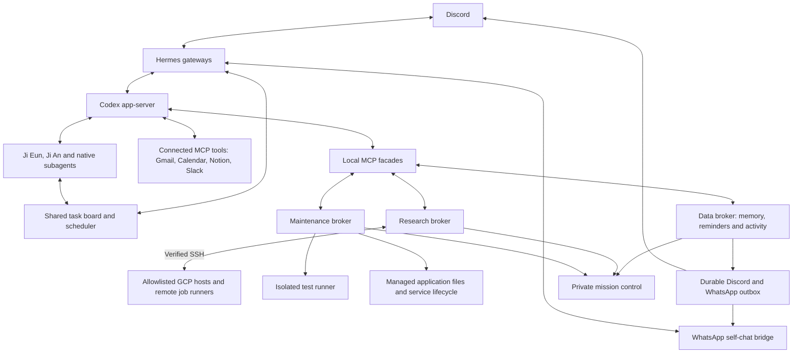
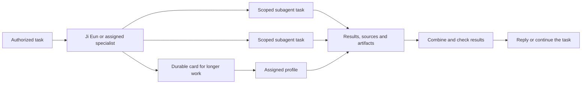
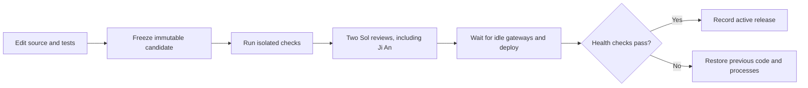

# Planet

I use this to give agents personal work and research tasks through chat, then follow what they actually do. I started as a weeknd project and now i would like to see what the the limit to automation like can these agents just write better code for themselves :) 

The project runs **Ji Eun** and **Ji An** on a Linux server through [Hermes Agent](https://github.com/NousResearch/hermes-agent) and the Codex app-server harness. Ji Eun handles conversation, email, scheduling and everyday work. Ji An handles scientific interpretation, experiment analysis and methodological review. They share structured memory and a task board. They can write code, delegate work to swarms, connect to configured research servers over SSH, and run requested experiments.

The current deployment uses Discord and WhatsApp Message yourself. Slack is connected as a read-only context source. The [organization setup](#using-it-in-an-organization) below covers Discord deployment and adaptation to Hermes's Slack chat adapter.

[Features](#features) · [Architecture](#architecture) · [Method](#method) · [Organization setup](#using-it-in-an-organization) · [Development](#development)

## Features

| Feature | What it does |
| --- | --- |
| Personal work | Search connected Gmail, inspect Google Calendar, handle requested scheduling, prepare daily briefs and make recommendations using relevant context. |
| Structured memory | Store facts by topic, source, confidence and validity period. Recall routines and explicitly supplied health constraints when relevant. Support corrections, expiry and forgetting. |
| Research | Search and assess scientific sources through enabled tools. Ji An reviews methods, results, uncertainty and alternative explanations. |
| Code work | Read and edit source in a writable checkout, add regression coverage and commit locally. Application changes can go through the maintenance release workflow. |
| SSH and experiments | Probe allowlisted GCP hosts, submit requested Codex or shell tasks, inspect recorded output and artifacts, and cancel a job by its stable ID. |
| Swarms | Delegate short work to native Codex subagents. Use persistent task cards, dependencies and comments for longer work and cross-profile handoffs. |
| Reminders and updates | Persist reminders for Discord or WhatsApp delivery. Send sourced updates and conversation starters under the configured owner policy. |
| Monitoring | Inspect sessions, delegation, visible tool calls, task state, research jobs and code-release checks in a private dashboard. Discord has separate activity and health channels. |

Email and calendar access comes through connected MCP tools. Notion and Slack context reads use the connected account's permissions. Recommendations about subscription value require usage evidence or a user report; receipts alone establish billing.

### Agents and models

| Agent or role | Current assignment | Model |
| --- | --- | --- |
| Ji Eun | Conversation, coordination, inbox and planning | Luna; Terra for everyday work and writing |
| Ji An | Scientific interpretation, experiment analysis and code review | GPT-6.1 Sol |
| Research and subscriptions | Source assessment and subscription review | GPT-6.1 Sol |

The deployment uses the owner's existing Codex subscription. Model IDs and role configuration live in [`deploy.py`](deploy.py) and [`configure-ji-an.py`](configure-ji-an.py). Each deployment needs its own authorized model access. No paid inference fallback is configured here.

## Architecture



Hermes handles messaging, sessions, profiles, scheduled work and the shared task board. Codex runs the model turns and native subagents. Local MCP facades call brokers over Unix-domain sockets. The brokers check the connecting process identity; that check applies to local service accounts.

The conversational service, data service, research service and build runner use separate Linux identities. A root-owned maintenance service handles a fixed set of deployment operations. Its application clients receive code-management tools rather than general sudo.

The dashboard binds to loopback on port `9120` and requires authentication. It shows visible events and tool output. Hidden model reasoning is excluded.

## Method

### 1. Receive a task and retrieve context

The gateway checks the sender and selects a session. The agent retrieves relevant topic- and time-scoped memory, then reads the connected sources needed for the task. Memory records keep their source and validity period. Imported documents and messages are treated as evidence; owner instructions determine the authorized work.

### 2. Delegate work when it helps

Short assignments use native Codex subagents. The configured concurrency cap is two native subagent threads per session. Agent instructions limit delegation to two levels and three handoffs before consolidation.

Longer assignments use Hermes task cards. Cards retain an assignee, dependencies, comments and a result or block reason. Ji Eun runs the shared dispatcher; the configured board limit is one in-progress task. Agents communicate through native handoffs and task comments. Bot-to-bot Discord messages do not start work.



These limits describe this deployment. A swarm is a set of delegated tasks with recorded results; the dispatcher and model configuration bound how much work runs concurrently.

### 3. Connect to a server and run an experiment

The [research broker](app/research_broker.py) checks the configured cloud identity, instance identity, running state and trusted SSH host key before contacting a host. A probe reports accessible project directories and available engines. The current transport uses GCP `gcloud compute ssh` with workforce authentication.

A submitted task carries the host, project directory, instructions, owner-request evidence, timeout and an idempotency key. The broker persists it before dispatch. The [remote runner](app/research_remote.py) starts a Codex task or a supplied shell task in the selected project directory. Codex requires an authenticated subscription on that server. The command engine runs with the SSH account's privileges.

Jobs retain a stable ID, status and visible events. The detached runner lets the job continue across an SSH disconnect. Reconnection polls the same job; a connection loss leaves its outcome unconfirmed until checked. Cancellation targets the recorded process group after checking its process identity. Ji An can inspect the output and artifacts to interpret results.

Task instructions request commands, seeds, revisions, metrics and artifact paths. Those records support checking a result; they do not establish that an experiment or interpretation is correct. Host setup does not start an experiment or provision a VM. The broker permits at most two outstanding research jobs. See [`research-policy.txt`](research-policy.txt) for the task policy.

### 4. Write code and release application changes

Agents work in `/var/lib/personal-agent/workspaces/scientific-assistants`. They can fix a concrete failure or add a capability using existing authorized connections and dependencies.



The [maintenance broker](maintenance/service.py) accepts a complete source candidate and runs fixed checks as an isolated build user. The build has a private network namespace, read-only source, restricted filesystem access and resource limits. Installed bridge dependencies are mounted read-only for tests.

Two distinct source-bound Sol approvals, including Ji An, are required for deployment. The broker journals the previous code, stops the application services, replaces allowed files, restarts services and checks their health. Failed deployment triggers restoration. Pending recovery blocks later queued releases; a constrained recovery tool can retry the recorded restoration. The owner's full-stop marker takes priority over restarts.

Deployable paths are direct application Python modules, dashboard JS/CSS/HTML and WhatsApp bridge JS/MJS. Administrator scripts, service policy and the maintenance machinery are protected. Peer attestations record a review workflow; they are not cryptographic proof of independent judgment. Local Git commits and runtime deployment are separate from publishing to GitHub. See [SELF-MAINTENANCE.md](SELF-MAINTENANCE.md).

### 5. Deliver and record the outcome

Agents report progress and actual outcomes to monitoring. Reminders use the persistent outbox and deterministic scheduler, without a model call at delivery time. Ambiguous send outcomes are retained for reconciliation instead of being retried blindly. Calendar changes use the connected provider; a local reminder does not continuously track subsequent calendar edits.

## Using it in an organization

The current application has one owner's memory, integrations and delivery destinations. For separate users, isolate their deployments or implement user-level authorization and data partitioning across memory, tasks, credentials, reminders and monitoring. Gateway sender allowlists do not partition the application database.

### Prepare the host

1. Install Linux with systemd, Python 3.11+ and Node.js 22+. Install the Hermes revision in [`upstreams.json`](upstreams.json), the Codex runtime and the dependencies used by the selected services. Authenticate with the organization's authorized accounts.
2. Adapt the deployment values below before running setup scripts. [`deploy.py`](deploy.py) creates the initial profiles and services and refuses an existing installation. Follow-up installers assume that host layout and other installed components; review their prerequisites and generated files first.
3. Configure the connected MCP accounts and tool permissions. Start with the sources needed for the deployment and verify the account identities.
4. For research, configure your own cloud identity, hosts, project directories and trusted host keys. The supplied research broker implements GCP; another cloud or generic SSH inventory requires a transport adaptation.
5. Set the expected platforms and service units in maintenance health checks to match your installation. Keep the dashboard private. Exercise an allowed message, a rejected sender, a reminder and a small code candidate before broader use.

| Deployment value | Files to adapt |
| --- | --- |
| Owner IDs, profiles, model access, connector IDs, timezone and filesystem layout | [`deploy.py`](deploy.py), [`configure-discord.py`](configure-discord.py), [`configure-ji-an.py`](configure-ji-an.py), [`enable-context.py`](enable-context.py) |
| Discord server, monitor channels and delivery recipients | [`setup-discord-monitor.py`](setup-discord-monitor.py), [`app/reminder_scheduler.py`](app/reminder_scheduler.py), [`app/discord_monitor.py`](app/discord_monitor.py) |
| Cloud project, workforce subject, host inventory and SSH setup | [`app/research_broker.py`](app/research_broker.py), [`app/research_admin.py`](app/research_admin.py), [`install-research.py`](install-research.py) |
| Source workspace, repository URL, service units and health checks | [`install-self-maintenance.py`](install-self-maintenance.py), [`maintenance/service.py`](maintenance/service.py), [`systemd/`](systemd/) |

Keep tokens, cloud logins and SSH keys in the deployment's protected credential stores. The repository excludes authentication files, runtime databases, private memory and conversation logs. The current model configuration sends selected task context to the remote model provider.

### Discord

Create a Discord application and bot for each separate bot identity. Enable Message Content Intent for this text-message setup. Invite the bot to the intended server with access to the required channels, message history, replies and attachments. Add thread permissions if using threads. Grant Manage Channels only if running the monitor-channel creation helper. The supplied setup does not use voice. See the [Hermes Discord setup guide](https://hermes-agent.nousresearch.com/docs/user-guide/messaging/discord) and [Discord's intent documentation](https://support-dev.discord.com/hc/en-us/articles/6207308062871-What-are-Privileged-Intents).

Adapt and run [`configure-discord.py`](configure-discord.py) in the server terminal to enter the token at a hidden prompt. Replace its owner ID and the matching deployment policy first. Keep explicit sender/admin allowlists, require a mention in shared channels, and leave bot-triggered work disabled. Configure the separate Ji An bot with [`configure-ji-an.py`](configure-ji-an.py). Point the monitor helper and delivery code at your own channels and recipients.

### Slack

Hermes supports Slack chat through Socket Mode, which uses an outbound WebSocket connection. Its [Slack setup guide](https://hermes-agent.nousresearch.com/docs/user-guide/messaging/slack) covers the gateway adapter. [Slack's Socket Mode documentation](https://docs.slack.dev/apis/events-api/using-socket-mode/) covers the app connection and permissions.

1. Generate the manifest with the pinned Hermes version: `hermes slack manifest --agent-view --write`. Review its scopes and events, then create an app in the intended workspace from that manifest.
2. Enable Socket Mode and create an app-level token with `connections:write`. Install the app to obtain its bot token. Enable Messages-tab access for DMs and invite the bot into the intended channels.
3. Supply `SLACK_BOT_TOKEN`, `SLACK_APP_TOKEN` and an explicit `SLACK_ALLOWED_USERS` member-ID list through protected runtime configuration. Enable the Slack platform in Hermes, configure administrator access and start the gateway. Test DMs and channel mentions.

This project's custom reminder/outbox code currently accepts Discord and WhatsApp destinations. Its monitor publisher targets Discord, and its maintenance health checks expect the current platforms. A Slack deployment must adapt those components and their tests for Slack delivery. Connecting the read-only Slack MCP context source does not enable Slack chat or those delivery paths.

## Development

Clone the repository using an account with access. Run these source checks from its root:

```sh
python3 -m venv .venv
. .venv/bin/activate
python -m pip install -r requirements-dev.txt
python -m unittest discover -s tests -q
node --test tests/*.test.mjs
node --check mission-control/app.js
```

The full upstream bridge suite also requires its npm dependencies. Install them in a development checkout and run:

```sh
npm --prefix whatsapp-bridge ci --ignore-scripts
node --test whatsapp-bridge/*.test.mjs
```

The deployed self-maintenance release passed **68 Python tests and 32 Node test results**, including the bridge suite. Two Sol reviews, live service checks, the authenticated dashboard and installed-file hashes were checked separately. These are recorded release results, not a claim about untested organizational deployments. Do not run host installers as unit tests. The fixed deployed check runner is [`maintenance/run_checks.py`](maintenance/run_checks.py).

## Repository map

| Path | Contents |
| --- | --- |
| [`app/`](app/) | Memory, reminders, research execution and monitor backend |
| [`plugin/`](plugin/) | Hermes personal-context integration |
| [`maintenance/`](maintenance/) | Source tools, isolated check runner and deployment broker |
| [`mission-control/`](mission-control/) | Private dashboard frontend |
| [`whatsapp-bridge/`](whatsapp-bridge/) | Bridge source, upstream tests and license |
| [`systemd/`](systemd/) | Service and timer definitions |
| [`tests/`](tests/) | Application regression tests |
| [`docs/deployed-server.md`](docs/deployed-server.md) | Deployment history and operational details |
| [`upstreams.json`](upstreams.json) | Pinned upstream versions |

## Current scope

Discord, WhatsApp self-chat, Gmail, Google Calendar, read-only Notion/Slack context, the GCP research transport and application self-maintenance have been exercised in the existing deployment. Separate iCloud calendars and selected WhatsApp group/chat ingestion remain pending. Voice is disabled. The Claude Code path exists but is disabled by the owner policy. The [latency/network redesign](design/latency-network-design.md) is a proposal awaiting implementation approval.

Upstream copyright notices and the WhatsApp pairing compatibility backport are documented in [THIRD_PARTY_NOTICES.md](THIRD_PARTY_NOTICES.md). Project-wide licensing has not been specified.
