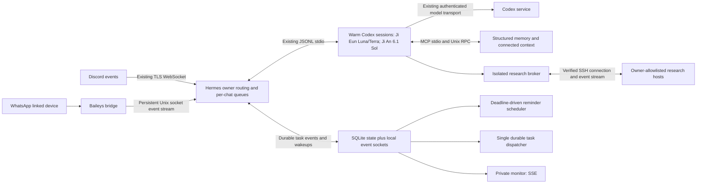

# Ji Eun / Ji An latency and network design

Status: proposed for owner review, 10 November 2026 India time. No runtime changes authorized by this document. Read-only inspection and local timing measurements only; no service restarts, new model calls, or latency settings changed during the audit.

## Decision

Use event-driven delivery over persistent local connections, keep existing Codex session reuse, and reduce unnecessary context/tool work. Retain Hermes and the existing Codex subscription. Ji Eun stays Luna/Terra; Ji An stays GPT-6.1 Sol. Implementation waits for the owner's approval.

## Baseline and limits of the evidence

| Observation | Result | Meaning |
| --- | --- | --- |
| Local structured-memory RPC, 30 sequential read-only requests | median 2.137 ms; sample p95 4.623 ms | Already inexpensive over Unix sockets; changing serializers has low priority. One small query, not a stress test. |
| Ji Eun Discord, last 15 completed native turns | median 29.165 s; range 2.146–338.238 s | Mixed conversation/tool-heavy work; not an apples-to-apples benchmark. These durations exclude unmeasured platform ingress/egress and are not first-token latency. |
| Ji Eun Discord, four turns with no recorded tool calls in that sample | 2.146, 3.314, 4.420, 13.782 s | Routine turns can already be quick; orchestration/context/provider variability needs tracing. |
| Ji An Discord, four completed native turns | median 3.091 s; no recorded tool calls | Too few/simple tasks to characterize scientific workload performance. Sol need not be downgraded. |
| WhatsApp, four completed native turns | 4.252, 3.569, 11.421, 3.986 s | The 11.421-second turn made two recorded tool calls. Small sample; platform delivery latency not included. |
| Ji Eun native conversation context | latest sampled input 127,274 tokens, of which 126,720 reported cached; earlier 163,512 before a reduction | Context has grown substantially. Cache hits already help; savings from compaction need measurement and cannot be assumed proportional to token reduction. |
| WhatsApp inbound | HTTP fetch followed by 1-second sleep; normal text batching defaults to 0.3 s | Adds a variable polling wait of up to about one second plus batching, before model work. |
| Reminders / durable Kanban / research polling | 15 s / 15 s / 30 s | Fixed loops add up to approximately their interval before the next check when idle. Busy workers, network time and failures add further delay. |
| Answer streaming | disabled in both live profiles | The owner sees text only after generation/delivery, although Codex already supplies streamed events. |
| Local model transport | existing persistent JSONL stdio with a cached AIAgent/session | Do not mistake the separate diagnostic CodexRPC helper for the production request path. Avoid rebuilding already-supported reuse. Idle agents normally expire after one hour. |
| Host at inspection | load average 0.25 / 0.12 / 0.05; about 4 GB available RAM, no swap used | No sign of host saturation in this snapshot; not proof about past spikes. |

There is currently no complete trace from provider message receipt through first rendered answer and final acknowledgement. Queue delay, cold-start rate, provider TTFT, network RTT and p95 end-to-end performance are not established by this audit. Do not present a promised 29-second-to-2-second speedup.

## Network layout

This represents logical flows. Ji Eun and Ji An retain their separate gateway ownership and credentials; the shared event layer does not merge their Discord identities or create a global chat bottleneck. Existing isolation between conversation, data and research users remains.

## Transports and event contracts

| Path | Proposed protocol | Behavior |
| --- | --- | --- |
| Discord ingress | Keep Discord's existing TLS WebSocket | Preserve provider message IDs, owner allowlist and ordering; no replacement transport. |
| WhatsApp bridge to Hermes | Persistent Unix stream socket, bounded UTF-8 JSONL records | Node `net` writer and asynchronous Python reader wake on arrival, replacing the one-second fetch loop. Stage as a reviewed adapter extension/isolated bridge change; retain the present HTTP adapter as rollback. |
| Hermes to Codex | Keep persistent documented JSON-RPC over stdio | Reuse current session and MCP processes; record cache misses and startup spans. Consider the installed Codex Unix-socket transport only if a later experiment demonstrates benefit; it is not required for this design. |
| Memory and research RPC | Keep Unix sockets and current permission boundaries | First preserve the already-fast path. Add request IDs and bounded persistent multiplexed connections only if profiling justifies them. A JSON-RPC 2.0 envelope is a migration option, not an immediate prerequisite. |
| Internal scheduling / task events | Unix socket notifications plus durable SQLite state | A committed `task.ready`, `notification.queued`, `memory.changed`, `job.finished` or `schedule.changed` wakes the relevant consumer. Separate queues and priorities for owner conversations, deadline delivery and background work. |
| Reminder sends | Pooled keep-alive HTTP to the existing bridge / Discord API | Sleep until the earliest due timestamp or a socket wakeup. Re-read durable state after waking; no arbitrary one-second busy loop. |
| Server monitor | Authenticated same-origin SSE, with bounded replay | Push sanitized state changes instead of repeatedly scanning state every three seconds. Disconnecting a monitor must not block agent execution. |
| Research | SSH multiplexing where compatible, then bounded job event streaming | Reuse a verified host connection while authorized. Keep strict host checks and invalidate connections at the credential/session boundary. |

JSON remains appropriate: measured local RPC cost is milliseconds. There is no demonstrated need for a binary serializer, extra network broker, or a custom transport to the model provider. External HTTPS/WebSocket transport remains owned by the supported clients. TCP socket options are not applied blindly; Unix sockets have no TCP/Nagle setting.

For persistent local event streams use a versioned envelope containing `event_id`, `sequence`, `trace_id`, `conversation_id` or `task_id`, `kind`, `timestamp`, `deadline` where applicable, and a bounded payload. RPC additionally uses a request ID; mutations keep their existing stable idempotency keys. Limits: 1 MiB per ordinary control record, bounded reader queues, and artifact references for large results. Never broadcast raw mail, health details or credentials to status consumers.

Events are delivered at least once with durable sequence cursors and idempotent consumers. Commit accepted work before acknowledging it, reconnect from the last acknowledged sequence, and rescan SQLite after disconnects or missed wakeups. Notifications accelerate durable state; they are not the sole record of work. Separate transient token deltas from durable accepted messages, task transitions and delivery outcomes so token streaming does not cause a database write per token. Mutations/sends with uncertain outcomes require reconciliation instead of automatic replay. This is not an exactly-once network guarantee.

Use file permissions, service identities and Unix peer credentials (`SO_PEERCRED`) for local access checks. Keep bounded deadlines, cancellation IDs, backpressure and per-conversation ordering. A background swarm cannot consume the interactive queue or grow without the existing concurrency bounds. A cancellation changes only its identified task; a newer turn must not receive an older turn's deltas.

## Changes with the largest expected impact

1. **Trace first.** Add monotonic spans for message accepted, queued, context ready, Codex ready, turn started, first eligible answer delta, first rendered text, final response and send acknowledgement. Record model, warm/cold, input/cache tokens, tool count, retry/compaction events and stage durations. Store timing metadata, not private prompt contents. Provider read receipts are separate from send acknowledgement. Show these spans in the existing monitor.
2. **Stream real answers.** Enable the supported output path after validating phase filtering. Stream only user-facing answer text, keeping context checks, tool narration and reasoning hidden. Start with approximately 500–1000 ms edit coalescing and obey platform rate limits. Flush final text immediately; do not fabricate progress. This improves time to first visible content; it does not itself shorten generation.
3. **Bound context growth.** Maintain a compact working summary of decisions, current commitments, corrections and artifact references, retrieving relevant structured facts on demand. Use supported compaction during idle periods with only one writer per conversation. Begin evaluation around a 40–60k total-context soft threshold, adjusting to the measured fixed instruction/tool floor and research needs. Preserve original history and durable evidence, and check summary accuracy before reuse. Personal health/routine constraints must still be recalled before relevant advice. Stable prompt prefixes should remain stable for cache reuse. Task-specific tool discovery/results should not endlessly accumulate in the main social conversation.
4. **Reuse warm sessions.** Preserve existing app-server/MCP reuse and durable thread IDs. Instrument eviction and prompt-change churn before increasing cache lifetimes. Keep a bounded hot set for Ji Eun/Ji An and let Terra start on demand, within the host's RAM budget; no synthetic model calls to keep a process warm. Avoid creating another daemon just to proxy already-persistent stdio.
5. **Reduce unnecessary serial work.** Routine conversation should not trigger mailbox, Slack or Notion scans. Independent source reads can run concurrently within existing limits. Take one relevant memory snapshot per turn, invalidating it on updates rather than repeatedly fetching unchanged context. For simple Ji Eun tasks, evaluate lower reasoning effort without changing model policy; Ji An remains 6.1 Sol for scientific interpretation. Calendar writes still require current availability checks. Cached health facts retain source/validity and never silently override new corrections.
6. **Replace scheduled waits.** Push WhatsApp arrivals immediately; wake reminder and task workers on state commits; use deadline timers for due reminders. Keep a slow recovery scan as a safety net. A free dispatcher should admit a ready task quickly, while occupied-worker wait remains visible. Do not raise durable worker concurrency merely to improve a latency graph.
7. **Stream research lifecycle updates.** Avoid repeating identity/token/instance-describe/SSH setup for every log poll. Establish and validate a session, cache only non-secret host metadata with clear expiry, stream task-scoped log/status changes, and revalidate on reconnect or identity change. No work after workforce authorization expiry; connection reuse must not extend permission. Preserve remote task IDs and cancellation/ambiguous-submission handling. A direct owner-requested fresh SSH probe remains a fresh probe.

## Measurement targets, not promises

Measure these after local receipt and report platform/provider time separately:

| Metric | Initial acceptance target |
| --- | --- |
| Accepted message to ready-to-start local turn, warm path | p95 below 500 ms including a bounded 100–300 ms burst-batching window; exclude provider/model wait and an already-busy conversation |
| Local memory RPC | p95 below 10 ms for the measured small-query class |
| Free dispatcher: committed ready task to admission | p95 below 250 ms |
| Due reminder to send attempt when connected and eligible | p95 below 1 s; provider acknowledgement measured separately |
| First eligible answer delta to platform edit submission | p95 below 1 s, subject to explicit provider rate limits |
| Routine warm Ji Eun reply | Aim for approximately 2–5 s to useful visible text; validate, do not guarantee |
| Scientific and tool-heavy tasks | Compare matched task categories; report retrieval, inference and execution separately |

Use median and p95 over matched warm/cold and tool/no-tool samples, ideally 30–50 paired tasks per affected path, spread out enough to avoid distorting the owner's service or allowance. Keep model, effort, source scope and prompt workload equivalent for the comparison. Cold cache after compaction must be reported separately. Validate reminder timing, rescheduling, owner isolation, interleaved chats, cancellation, replay after restart, duplicate events, provider rate limits, offline recovery and prompt/memory fidelity. No benchmark should launch experiments or contact third parties.

## Rollout after approval

1. Capture proper traces and run baseline checks. Use the existing monitor. No inference-transport rewrite.
2. Trial answer streaming and task/context hygiene on a controlled conversation. Preserve exact model assignments. Roll back if private narration leaks, answers regress or cancellation misroutes.
3. Replace WhatsApp and reminder polling; then add durable task wakeups. Deploy one transport boundary at a time with existing polling as the recovery/rollback path.
4. Add research stream/SSH reuse and monitor SSE after the interactive path is verified. Keep current authenticated dashboard access; no new public listener.

Extensions to the pinned Hermes version must use supported configuration/plugin hooks where available. If a required hook is absent, review a narrowly scoped adapter change separately; do not silently patch the vendor tree or replace the harness. Keep phase filters and the recent WhatsApp pairing compatibility fix intact.

Before each deployment save reviewed configuration, drain or preserve in-flight work, and verify existing Discord/WhatsApp connectivity, memory and reminder delivery. An owner-approved implementation is still subject to the above isolation and model constraints. This design makes no runtime changes by itself.

## Sources

Read-only audit of installed files: Hermes `agent/codex_runtime.py`, `agent/transports/codex_app_server*.py`, `gateway/agent_cache_pressure.py`, `gateway/run_agent_cache.py`, `gateway/config.py`, WhatsApp/Discord adapters; local `assistant_broker.py`, `reminder_scheduler.py`, `research_broker.py`, monitor services and live model/display configuration. Recent owner-session timing/token metadata was summarized without copying message content or authentication files. The diagnostic client `app/codex_rpc.py` is not the live conversation path.

Official OpenAI documentation: [Codex App Server](https://learn.chatgpt.com/docs/app-server), particularly stdio JSONL transport, streamed agent-message events, thread resume and `thread/compact/start`. The installed CLI's read-only help also advertises Unix transport; no transport mode was changed. TCP WebSocket transport is marked experimental in the documentation, so the proposed first phase retains stdio.
